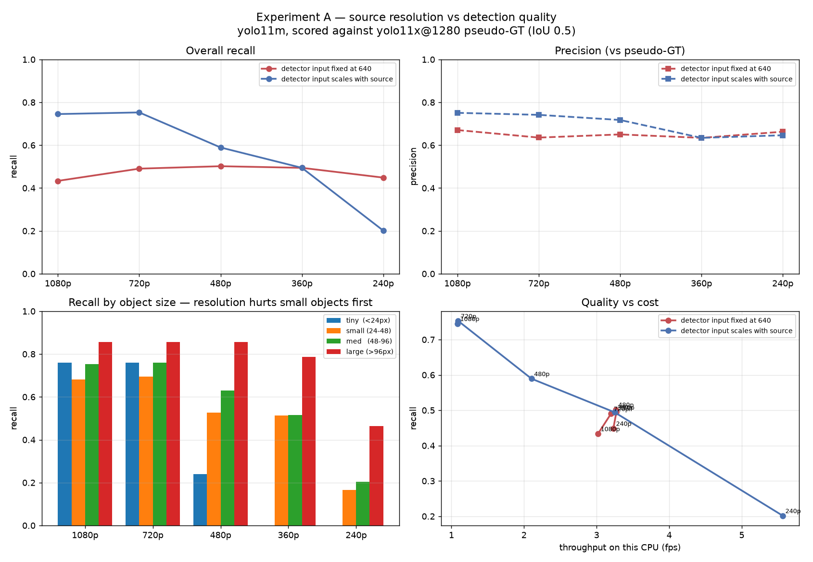
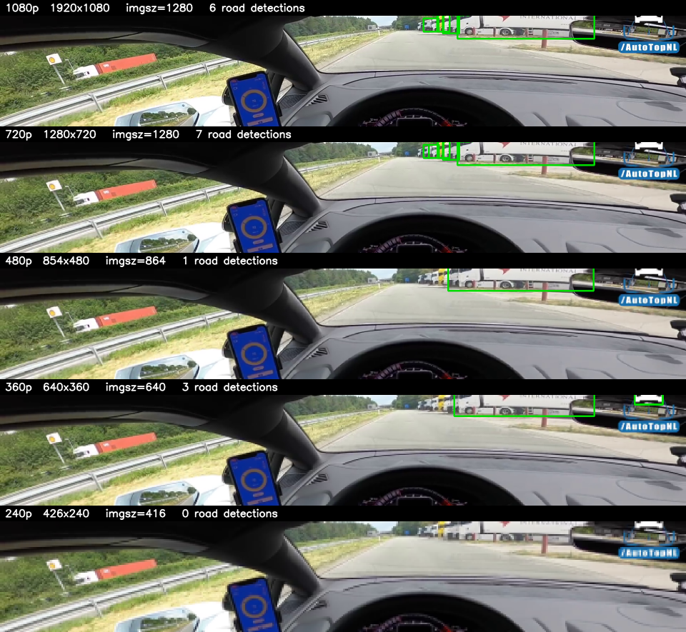
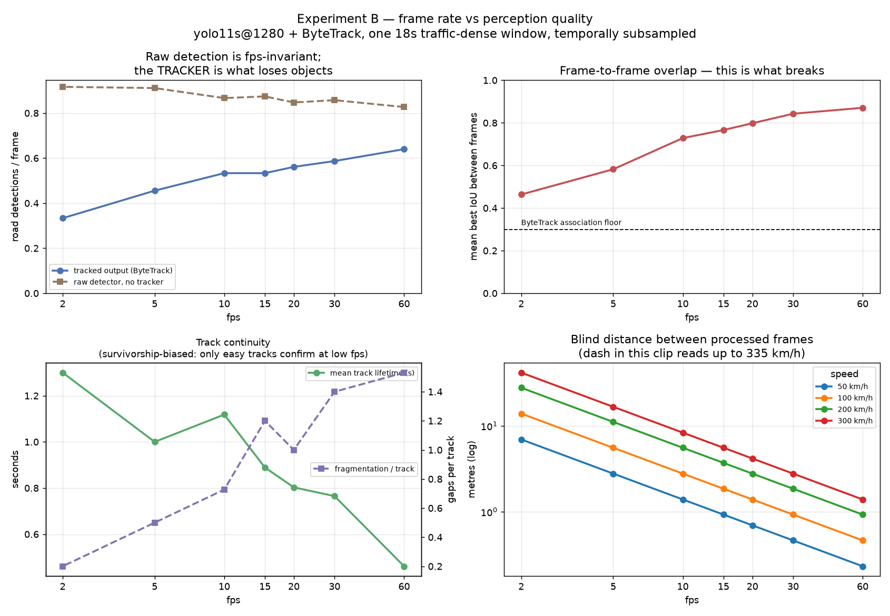
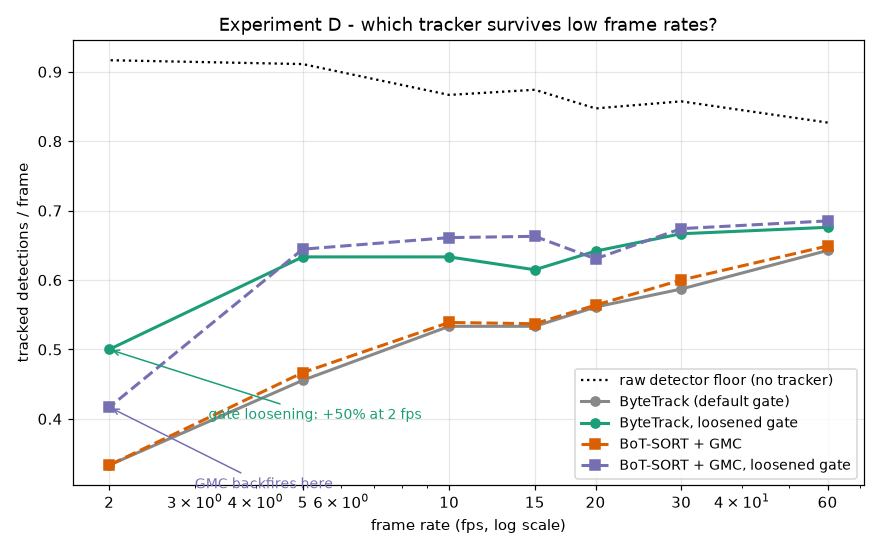

# Resolution and frame rate vs YOLO detection quality

Dashcam clip: 281 s, AutoTopNL German Autobahn run, cabin-POV. Every condition derives from the **same 1080p master**, so resolution and frame rate vary independently of codec, bitrate and scene content.

## Read this first: what the footage forced

Four properties of this video shaped every number below.

1. **Only frames 3460-16855 (57.6 s onward) are driving.** The opening ~57 s is a static beauty shot of the parked car on a cobblestone driveway, plus a second cabin angle with no road view. Found by frame-differencing; after 57.6 s there are no cuts.

2. **The camera is inside the cabin and drifts.** A hand-drawn windscreen ROI that fits at 207 s sits on the dashboard at 58 s. Geometric ROIs were abandoned; scoring instead keeps only boxes whose centre lies in the upper 400 px (37%) of the master frame, which survives the drift.

3. **The driver is detected as `person` in every frame** - a large, close, trivially detected object that would flatten the very curve being measured. Class dropped; Autobahns have no pedestrians.

4. **94% of driving frames contain no road object at all.** A pre-screen of 2233 frames found 137 with at least one object, clustered into 22 traffic events. The condition grid was aimed at those events; a uniform sample scored only 27 objects.

A fifth constraint is structural: **COCO has no class for European road signs.** Stock YOLO cannot detect the blue motorway or red prohibition signs in this clip at any resolution, so the sign question is unanswerable with off-the-shelf weights.

## How quality was measured

No human labels exist for this footage, so quality is **agreement with a strong detector**, not absolute truth: `yolo11x` at `imgsz=1280`, conf 0.30, on the untouched 1080p frame. Test configs run `yolo11m` at conf 0.25, matched greedily by IoU >= 0.5. `car`/`truck`/`bus` collapse into one `vehicle` class because COCO detectors swap them constantly and that is label noise, not a resolution effect.

No config can score above the reference, and errors the reference also makes are invisible. This is the right tool for ranking configs against each other and the wrong tool for quoting an absolute mAP.

A classical HSV colour + contour sign detector was built (`classic_signs.py`) as an *independent* cross-check, on the theory that its errors would be uncorrelated with a CNN's. Audited over 52 detections it scored **~21% precision**, the failures being red truck rear panels, taillights, and the driver's blue phone screen. Those errors correlate with road content, which makes it useless as a reference. Recorded here as a negative result; it is not used in scoring.

## Experiment A - resolution

**263 scored objects across 180 frames and 17 traffic events.**

**Detector input fixed at 640** (what you get by default):

| source | imgsz | recall | precision | F1 | ms/frame | fps |
|---|---|---|---|---|---|---|
| 1080p | 640 | 0.433 | 0.671 | 0.527 | 331 | 3.02 |
| 720p | 640 | 0.490 | 0.635 | 0.554 | 313 | 3.20 |
| 480p | 640 | 0.502 | 0.650 | 0.567 | 306 | 3.26 |
| 360p | 640 | 0.494 | 0.634 | 0.556 | 306 | 3.27 |
| 240p | 640 | 0.449 | 0.663 | 0.535 | 310 | 3.23 |

**Detector input scales with source:**

| source | imgsz | recall | precision | F1 | ms/frame | fps |
|---|---|---|---|---|---|---|
| 1080p | 1280 | 0.745 | 0.751 | 0.748 | 924 | 1.08 |
| 720p | 1280 | 0.753 | 0.742 | 0.747 | 915 | 1.09 |
| 480p | 864 | 0.589 | 0.718 | 0.647 | 476 | 2.10 |
| 360p | 640 | 0.494 | 0.634 | 0.556 | 308 | 3.25 |
| 240p | 416 | 0.202 | 0.646 | 0.307 | 180 | 5.56 |

### Recall by object size - the headline

Bins are box height in master-1080p pixels: roughly how far away the object is.

*fixed 640:*

| source | tiny <24px | small 24-48 | med 48-96 | large >96px |
|---|---|---|---|---|
| 1080p | 0.000 | 0.458 | 0.449 | 0.679 |
| 720p | 0.000 | 0.514 | 0.507 | 0.786 |
| 480p | 0.000 | 0.528 | 0.514 | 0.821 |
| 360p | 0.000 | 0.514 | 0.514 | 0.786 |
| 240p | 0.000 | 0.458 | 0.457 | 0.786 |

*scaled input:*

| source | tiny <24px | small 24-48 | med 48-96 | large >96px |
|---|---|---|---|---|
| 1080p | 0.760 | 0.681 | 0.754 | 0.857 |
| 720p | 0.760 | 0.694 | 0.761 | 0.857 |
| 480p | 0.240 | 0.528 | 0.630 | 0.857 |
| 360p | 0.000 | 0.514 | 0.514 | 0.786 |
| 240p | 0.000 | 0.167 | 0.203 | 0.464 |

Bin sizes: n = 25, 72, 138, 28.

**At `imgsz=640`, objects under 24 px are detected 0% of the time at every source resolution.** Raising `imgsz` to 1280 lifts that to 0.760. Large objects (>96 px) barely move at all.





### Which differences are statistically real

Boxes within one traffic event are the same vehicles seen repeatedly, so naive binomial errors on 263 boxes would badly overstate confidence. This bootstrap resamples whole events (17 clusters, B=4000).

```
cluster bootstrap over 17 traffic events, B=4000

Does extra source resolution help when imgsz is FIXED at 640?
  fixed640 @ 1080p             0.433 [0.328,0.622]
  fixed640 @ 480p              0.502 [0.412,0.698]
     diff -0.068  95% CI [-0.291,+0.136]  -> not distinguishable

Does 1080p beat 720p when imgsz scales?
  native @ 1080p               0.745 [0.625,0.885]
  native @ 720p                0.753 [0.650,0.892]
     diff -0.008  95% CI [-0.179,+0.160]  -> not distinguishable

Does 720p beat 480p when imgsz scales?
  native @ 720p                0.753 [0.648,0.890]
  native @ 480p                0.589 [0.483,0.774]
     diff +0.163  95% CI [-0.047,+0.329]  -> not distinguishable

Does scaling imgsz beat fixing it, at the same 1080p source?
  native @ 1080p               0.745 [0.636,0.882]
  fixed640 @ 1080p             0.433 [0.327,0.619]
     diff +0.312  95% CI [+0.109,+0.478]  -> SIGNIFICANT

TINY objects only (<24px): native 1080p vs fixed640 1080p
  native @1080p, tiny          0.760 [0.565,0.938]
  fixed640 @1080p, tiny        0.000 [0.000,0.000]
     diff +0.760  95% CI [+0.565,+0.938]  -> SIGNIFICANT
```

Surviving claims: **`imgsz` is what matters, source resolution is not**, and **1080p buys nothing over 720p**. The 720p-vs-480p gap (+0.163) does *not* reach significance with 17 clusters.

## Experiment B - frame rate

`yolo11s` at `imgsz=1280`, 1280x720 frames, densest 18 s window (115.7-133.7 s), ByteTrack, road band only.

| fps | frames | tracked det/frame | frame-to-frame IoU | tracks | blind gap @50 | @200 | @300 km/h | latency ms |
|---|---|---|---|---|---|---|---|---|
| 60 | 1080 | 0.640 | 0.871 | 32 | 0.23 | 0.93 | 1.39 | 17 |
| 30 | 540 | 0.587 | 0.843 | 20 | 0.46 | 1.85 | 2.78 | 33 |
| 20 | 360 | 0.561 | 0.798 | 17 | 0.69 | 2.78 | 4.17 | 50 |
| 15 | 270 | 0.533 | 0.766 | 15 | 0.93 | 3.70 | 5.56 | 67 |
| 10 | 180 | 0.533 | 0.728 | 11 | 1.39 | 5.56 | 8.33 | 100 |
| 5 | 90 | 0.456 | 0.582 | 10 | 2.78 | 11.11 | 16.67 | 200 |
| 2 | 36 | 0.333 | 0.464 | 5 | 6.94 | 27.78 | 41.67 | 500 |

### Control: the detector is fps-invariant, the tracker is not

Detection is per-frame independent, so running the detector once over all 1080 frames and averaging over each condition's subsample isolates the tracker's contribution.

| fps | raw det/frame (no tracker) | tracked det/frame | retained |
|---|---|---|---|
| 60 | 0.827 | 0.640 | 77% |
| 30 | 0.857 | 0.587 | 68% |
| 20 | 0.847 | 0.561 | 66% |
| 15 | 0.874 | 0.533 | 61% |
| 10 | 0.867 | 0.533 | 62% |
| 5 | 0.911 | 0.456 | 50% |
| 2 | 0.917 | 0.333 | 36% |

Raw detection is flat (0.827-0.917, no trend). Tracked output falls 0.640 to 0.333. **The entire loss is ByteTrack withholding boxes whose tracks it cannot confirm** - 77% of detections survive tracking at 60 fps, only 36% at 2 fps.

Mean frame-to-frame IoU falls 0.871 to 0.464 against ByteTrack's ~0.3 association floor: by 2 fps a moving vehicle barely overlaps itself between frames, so the tracker assigns it a new identity.

**Track-continuity figures are survivorship-biased.** Mean track lifetime *rises* as fps falls (0.46 s to 1.30 s) and fragmentation *falls* (1.53 to 0.20). That is not low fps improving tracking; only large, close, easy objects ever confirm a track at 2 fps.

The `infer_ms` column in the CSV was measured under CPU contention and is not trustworthy. A clean benchmark for this config is ~247 ms/frame, i.e. a ~4 fps real-time ceiling on this machine (CPU only, no CUDA).



## Experiment C - road-band crop

Experiment A left one lever untried. Full frame 1920x1080 into a square `imgsz=1280` scales everything by 0.667, so a 24 px object reaches the network as 16 px - which is why recall on objects under 24 px was **zero** at `imgsz=640` and only recovered when `imgsz` rose to 1280. But the road occupies a ~310 px horizontal band; the rest is sky and dashboard. Cropping to that band and running **rectangular** inference at (320, 1920) keeps every object at its **native** pixel size while processing 0.61 MP instead of the square's 1.64 MP - in principle better small-object recall *and* less compute at once.

Same reference and the same 284 frames / 263 objects as Experiment A; the only variable is the crop. The baseline row reproduces Experiment A's `native @ 1080p` exactly (recall 0.745, F1 0.748, bins 0.760/0.681/0.754/0.857), which confirms the two harnesses measure the same thing.

| config | recall | precision | F1 | tiny <24 | small 24-48 | med 48-96 | large >96 |
|---|---|---|---|---|---|---|---|
| full frame `imgsz=1280` (baseline) | 0.745 | **0.751** | **0.748** | 0.760 | 0.681 | 0.754 | **0.857** |
| band 320 px, native (320,1920) 6:1 | 0.730 | 0.516 | 0.605 | **0.800** | **0.750** | 0.725 | 0.643 |
| band 480 px, native (480,1920) 4:1 | 0.715 | 0.618 | 0.663 | 0.720 | 0.736 | 0.717 | 0.643 |
| band 640 px, native (640,1920) 3:1 | 0.719 | 0.652 | 0.684 | 0.760 | 0.736 | 0.710 | 0.679 |

Bin sizes: n = 25, 72, 138, 28.

**The hypothesis is refuted as a net win.** Its one true prediction survives - native-size inference lifts **small** (24-48 px) recall from 0.681 to 0.750 at every band, and the tightest band nudges tiny recall up too (0.760 to 0.800). But that gain is bought at a price that dwarfs it:

- **Precision collapses**: 0.751 to 0.516 at the 320 px band. The crop manufactures false positives.
- **Large-object recall is wrecked**: 0.857 to 0.643. A large, close vehicle extends past a 310 px band, and a box clipped by the crop edge either fails to match or is dropped.

Net **F1 is worse at every band** (0.748 to 0.605 / 0.663 / 0.684). Full frame `imgsz=1280` stays the operating point.

The mechanism is the aspect ratio itself. Precision tracks it monotonically - 0.516 at 6:1, 0.618 at 4:1, 0.652 at 3:1 - recovering as the strip gets less extreme. A 6:1 input is nothing like the near-square letterboxed frames YOLO trains on, and the model emits spurious boxes in the unfamiliar geometry, concentrated by inspection near the crop's top and bottom edges where the band clips partial objects. This is an aspect-ratio effect, not a fixed edge artefact, or it would not scale with the ratio.

**The compute half of the hypothesis is untested here.** These runs shared the CPU with the tracker sweep running concurrently, so the `ms/frame` column (omitted above) is contention-contaminated exactly as Experiment B's `infer_ms` was, and cannot support the "less area is faster" claim. A clean single-process timing run is still owed - but since the accuracy half already loses, it would only decide *how cheaply* a worse operating point runs.

What would rescue the idea: kill the precision leak while keeping the native-size small-object gain - a square-ish crop such as (640, 640) centred on the band rather than a 6:1 strip, or edge-margin suppression on the clipped rows. Until then this is a **negative result**: the road-band crop trades away more than it buys.

## Experiment D - does a better tracker undo the frame-rate penalty?

Experiment B pinned the frame-rate loss on the tracker, not the detector: raw detections/frame are flat across fps, but ByteTrack's default IoU gate cannot link a fast object to itself across a large time step, so it withholds boxes - 77% of detections survive tracking at 60 fps, only 36% at 2 fps. Two fixes suggest themselves, and this tests both against the baseline, everything else held identical to Experiment B (same 18 s window, same `yolo11s` at `imgsz=1280`, same 1280x720 frames, same road band):

- **`bytetrack_tuned`** - loosen the association gate only (`match_thresh` 0.8 -> 0.95, i.e. accept a match down to IoU 0.05 instead of 0.2).
- **`botsort_gmc`** - BoT-SORT with global motion compensation (sparseOptFlow), which estimates the camera's own motion between frames and warps predictions by it before matching - in principle the right tool for a forward-racing dashcam.
- **`botsort_gmc_tuned`** - both at once.

Tracked detections per frame (higher = fewer boxes withheld; raw floor is the fps-invariant detector output from Experiment B's control):

| fps | raw floor | bytetrack | bytetrack_tuned | botsort_gmc | botsort_gmc_tuned |
|---:|---:|---:|---:|---:|---:|
| 60 | 0.827 | 0.643 | 0.676 | 0.649 | **0.685** |
| 30 | 0.857 | 0.587 | 0.667 | 0.600 | **0.674** |
| 20 | 0.847 | 0.561 | **0.642** | 0.564 | 0.631 |
| 15 | 0.874 | 0.533 | 0.615 | 0.537 | **0.663** |
| 10 | 0.867 | 0.533 | 0.633 | 0.539 | **0.661** |
| 5 | 0.911 | 0.456 | 0.633 | 0.467 | **0.644** |
| 2 | 0.917 | 0.333 | **0.500** | 0.333 | 0.417 |

Three findings, one of them against expectation.

**The cheap fix works.** Loosening the gate alone lifts tracked output by +0.103 det/frame averaged over fps, and at 2 fps it recovers 0.333 to 0.500 - a +50% jump, half the frame-rate penalty erased by one threshold. Retained fraction of the raw floor at 2 fps rises from 36% to 55%.

**Global motion compensation, alone, does nothing.** `botsort_gmc` tracks within noise of plain ByteTrack at every fps (+0.006 det/frame averaged; identical 0.333 at 2 fps). The dashcam's forward motion is not what breaks association here - the *relative* motion of other vehicles across a 0.5 s gap is, and GMC does not touch that.

**GMC plus the loosened gate is best at moderate fps but backfires at the extreme.** `botsort_gmc_tuned` leads from 60 down to 10 fps, but at 2 fps it falls to 0.417, *below* the gate-only 0.500. The mechanism is GMC turning on itself: sparseOptFlow needs frame-to-frame correspondences to estimate ego-motion, and at 2 fps and highway speed consecutive frames barely overlap, so the motion estimate itself degrades and warps predictions wrongly - GMC hurts precisely where the frame rate is lowest and help is needed most.

Timing settles it. On the GPU (RTX 3060, `yolo11s` at `imgsz=1280`), the two ByteTrack arms run ~20 ms/frame (~50 fps, real-time to spare); the GMC arms cost ~29-38 ms and, tellingly, get *slower* as fps drops (35-38 ms at 2 fps) as optical flow labours over larger gaps. So `bytetrack_tuned` wins on all three axes at once - best quality at the hard end, simplest, and fastest. A better tracker does undo much of the frame-rate penalty; the better tracker is the cheaper one.

This run also retires Experiment B's timing caveat. That `~247 ms/frame, ~4 fps real-time ceiling` was CPU-only under contention; on this GPU the same config sustains ~20 ms/frame, a ~48 fps ceiling, and these numbers are measured on a dedicated device with nothing else running.



## Limits

- **Effective sample is 17 traffic events / 32 tracks**, not 263 boxes. Enough for the large effects reported; not enough for precise fragmentation rates.

- **Pseudo-ground-truth, not ground truth.** Blind spots shared with `yolo11x` are invisible. Hand-labelling a small set, or a TTA/ensemble reference, would measure that bias.

- **This clip is a poor instrument for the question**: cabin POV wastes ~90% of pixels, the camera drifts, traffic is sparse, and the most interesting objects (signs) are not COCO classes. The code transfers unchanged to a road-facing clip with steady traffic, which would answer it far better.
